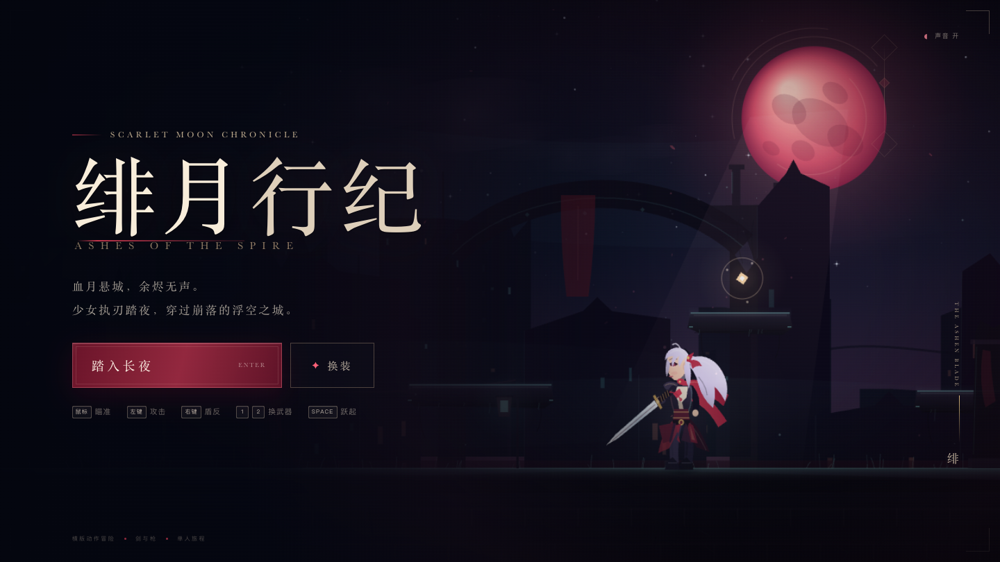
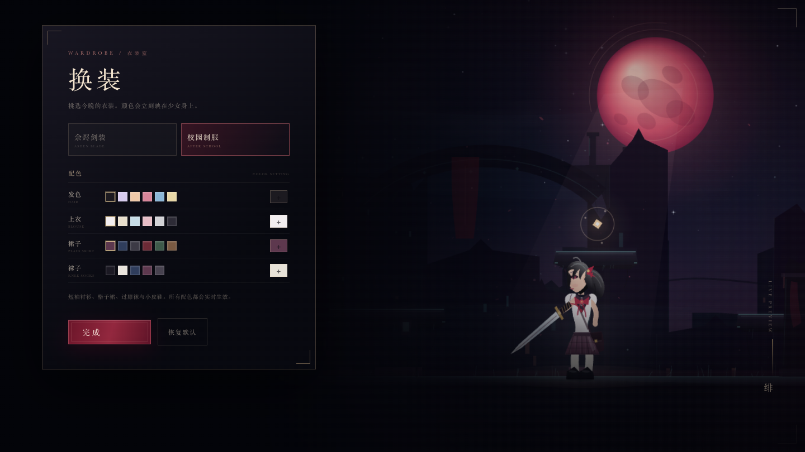
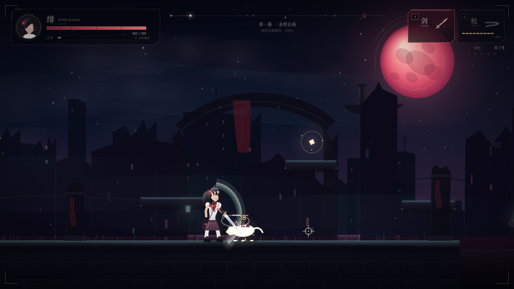
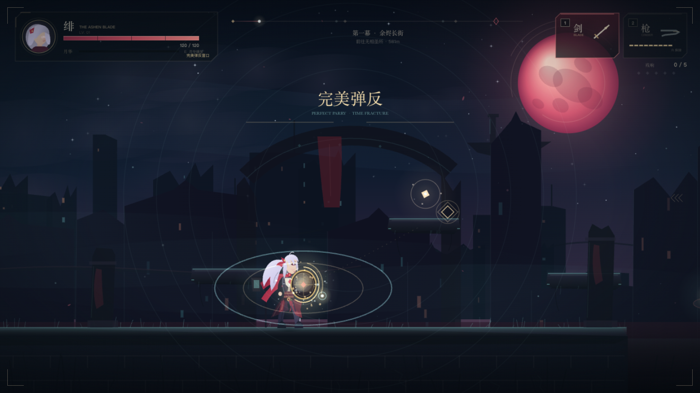
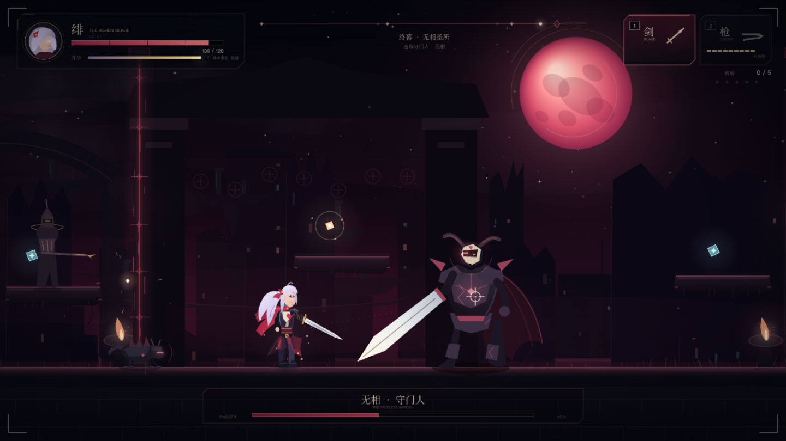

# 绯月行纪 · Scarlet Moon Chronicle

一款纯前端制作的横版动作冒险游戏。血月之下，可换装的少女「绯」提着断罪之刃穿过崩落的浮空城；这一次，她用鼠标瞄准，用剑与枪讨伐圣所深处的守门人。



## 开始游戏

直接用 Chrome / Edge / Safari 打开 `index.html` 即可，无需安装依赖。

如果浏览器对本地文件限制较多，也可以在项目目录启动静态服务器：

```bash
python3 -m http.server 8000
```

然后访问 `http://localhost:8000`。

> 声音需要点击页面后才会启用。手机端请横屏游玩。

## 操作

| 操作 | 动作 |
| --- | --- |
| `A` / `D` 或 `←` / `→` | 移动 |
| 移动鼠标 | 角色朝向光标，并确定攻击方向 |
| 鼠标左键 | 使用当前武器攻击（枪可按住连射） |
| 鼠标右键 | 举盾；点按可完美弹反，长按持续防御 |
| `1` / `2` | 切换剑 / 枪 |
| `SPACE` | 跳跃 / 二段跳 |
| `SHIFT` / `L` | 冲刺闪避（短暂无敌） |
| `E` | 月华爆发（能量满时） |
| `R` | 手动换弹 |
| `ESC` / `P` | 暂停 |
| `M` | 声音开关 |
| `ENTER` | 标题界面开始游戏 |

手机 / 平板横屏时会显示触屏按键：左侧移动，右侧「盾、闪、月、换、攻、跃」。触屏攻击会自动锁定附近敌人。

## 盾反机制

- **完美弹反**：按下右键后的 **0.5 秒**内，盾牌会反弹一切来袭攻击。飞行道具会被反射，近战攻击会让攻击者受到反噬。
- **时间凝滞**：成功完美弹反后，世界中所有单位的时间流速降至 **30%**（减速 70%），持续 **1 秒**。
- **持续防御**：举盾超过 0.5 秒后，盾牌转为普通防御，受到的伤害降低 **30%**。举盾期间移动速度降低，并且不能攻击。

## 换装间

主菜单点击「换装」进入衣装室，可以实时预览并选择：

- **余烬剑装**：默认战斗服，可更换发色。
- **校园制服**：短袖水手领衬衫、格纹百褶裙、过膝袜、小皮鞋与黑色短发。
- 可以分别指定 **发色、上衣颜色、裙子颜色、袜子颜色**；所有配色都会立即映在角色身上，并保存在浏览器本地。



## 游戏内容

- **双武器战斗**：剑有完整的三段连斩与刀光判定；枪有自由瞄准、连射、弹匣与换弹，近战与远程可以随时用 `1` / `2` 切换。
- **鼠标指向攻击**：剑击和射击都朝光标方向发动，可以攻击头顶、背后和空中的敌人。
- **横版探索关卡**：三幕式连续关卡，包含断裂地形、浮空平台、隐藏高处的残响与补给。
- **敌人与 Boss**：游猎兽、浮空幽影、圣所哨兵，以及拥有两个阶段、会横扫 / 弹幕 / 冲撞的守门人「无相」。
- **成长与续航**：击破敌人积攒「月华」，满能量可释放大范围「斩夜」并回复生命；篝火可作为复活点。
- **氛围表现**：多层视差废墟、血月、粒子、屏幕震动、命中停顿、程序化音效与动态背景音乐。







## 文件结构

```text
index.html          页面与界面结构
style.css           标题、换装、弹窗、触屏与竖屏提示样式
js/utils.js         数学、颜色、绘图与碰撞工具
js/audio.js         Web Audio 程序化音效与背景音乐
js/input.js         键盘、鼠标与触屏输入
js/world.js         关卡数据、视差背景与地形绘制
js/hero.js          主角「绯」的移动、战斗、盾反与逐帧绘制
js/enemies.js       敌人与 Boss 的行为、攻击与绘制
js/ui.js            HUD、对话、章节卡与 Boss 血条
js/wardrobe.js      换装界面、配色与本地保存
js/game.js          游戏循环、关卡流程、粒子与状态管理
screenshots/        预览截图
```

## 小提示

- 枪的弹匣打空后会自动换弹，也可以按 `R` 提前装填。
- 冲刺期间短暂无敌，可以穿过弹幕。
- 空中可以再跳一次；从平台边缘走落时也还能补跳。
- 掉入深渊会损失生命并回到最近的篝火。
- 五枚「残响」散落在高处，收集它们可以了解这座城的故事。
- 用右键挡住 Boss 的横扫，再在 0.5 秒窗口内接住子弹，可以打出非常漂亮的反击节奏。
